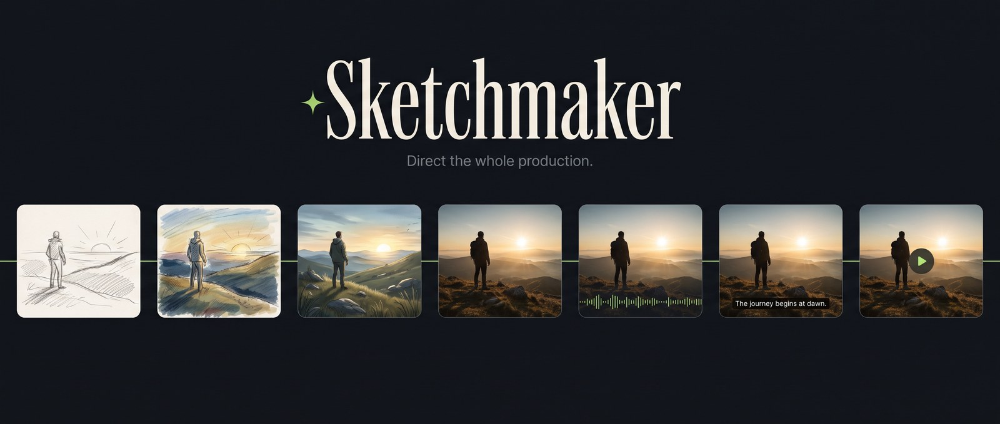

# Sketchmaker: Self-Hosted, Open-Source AI Studio for Video and Images

[](LICENSE)
[](https://www.python.org/)
[](https://fastapi.tiangolo.com/)
[](https://react.dev/)
[](https://vite.dev/)
[](https://www.typescriptlang.org/)
[](https://www.sqlite.org/)
[](docs/DEPLOYMENT.md)



> **Direct the whole production, on your own machine.** Make faceless videos, motion graphics, stories, lip sync, logos and images in one studio, with your own API keys. No subscription, no credits and no markup: you pay the AI providers directly, and every paid step shows an estimated price before it runs.

## 🚀 Quick Start

### Prerequisites

- [uv](https://docs.astral.sh/uv/getting-started/installation/)
- [Node.js](https://nodejs.org/) 22 or newer
- [ffmpeg](https://ffmpeg.org/), for video tools and renders (Windows: `winget install Gyan.FFmpeg`, Linux: `sudo apt install ffmpeg`, macOS: `brew install ffmpeg`)
- A [fal](https://fal.ai/) key for images and video, and a key from any supported language model provider

### Setup

```bash
git clone https://github.com/marketcalls/sketchmaker.git
cd sketchmaker
uv run run.py
```

The same command works on Windows, Linux and macOS. On Windows you can also double-click `run.bat`.

That one command creates `backend/.env` with random secrets, builds the frontend, creates the database, and starts the app:

```
First run. Create your account at:
  http://127.0.0.1:8000
```

Open it, press **Login**, and choose a username and a password of at least 12 characters. Then go to **Settings > API keys** and add:

- a **fal** key, for images and video
- a **language model** key (OpenAI, Anthropic, Gemini, Groq, xAI, Cerebras, OpenRouter or Baseten), for scripts, Magic Prompt and the story tools
- a **Sarvam** key, only if you want Bulbul voices for Indian languages

Pick your language model under **Settings > AI model**.

### 🐳 Run with Docker

```bash
docker compose up -d --build
```

Then open `http://127.0.0.1:8000`. The container runs as a non-root user on a read-only filesystem, with every Linux capability dropped.

### 🌐 Publish on Your Domain

For a team using it from their own computers, on a fresh Ubuntu LTS server with your domain already pointing at it:

```bash
curl -fsSL https://raw.githubusercontent.com/marketcalls/sketchmaker/main/server/install.sh -o install.sh
sudo bash install.sh
```

The installer sets up HTTPS with Let's Encrypt, nginx, a sandboxed service, a firewall, fail2ban and automatic security updates, and creates your login in the terminal. To update later, run `sudo bash /var/www/sketchmaker/server/update.sh`, which undoes itself if the new version does not come up healthy.

> **Heads up:** the server scripts and the Docker setup have been linted and rehearsed, but not yet run on a real Ubuntu server or in Docker. Try them on a throwaway server first.

Everything about servers, updates, rollback, moving servers and Docker is in **[docs/DEPLOYMENT.md](docs/DEPLOYMENT.md)**.

## ✨ Features

- **Faceless Studio** — Turn an idea into a finished video: recurring cast, series, script, storyboard, animated clips, voiceover, music, word-synced captions and one final render. Shorts up to 3 minutes, long-form up to 15.
- **Motion Graphics** — Data and kinetic typography videos: stat and number reveals, charts, quotes, lists, lower thirds and logo reveals, in your brand colours and fonts.
- **Story Room and Video Stories** — Develop a story with a language model, then make it into video with text, image or reference-to-video on five models.
- **Image Generation** — Nine models with styles and aspect ratios.
- **Lip Sync** — Make a portrait speak from an audio file or a generated voice, up to 2K.
- **Logo Studio** — Answer a short brief and get vector SVG logos, then refine or simplify them, or turn an image into a vector. Recolor, lockups, the brand kit and mockups cost nothing.
- **Magix Photography** — Twenty-two professional portrait styles that keep the face.
- **Virtual Try-On** — A photo plus a garment gives a realistic fit.
- **Motion Control** — Copy the movement of a reference video onto your character, up to 30 seconds.
- **Visual Explainers** — Infographics, flowcharts, timelines and diagrams from one prompt, up to 4K.
- **Auto Subtitles** — Transcription in 10+ languages with styled captions for social.
- **Remove Background** — Clean cut-outs with a transparent background.
- **Reduce** — Resize and convert images on your own machine, at no cost.
- **My Gallery, My Assets and My Jobs** — Everything you make is kept on your disk, and you can follow or cancel work in progress.
- **Usage** — Estimated spending by tool and model, with a log of each paid request.
- **Refresh Models** — Ask your providers what they offer now and add new language models, without waiting for an update.
- **Secure Key Storage** — Provider keys are encrypted in the database, never shown again, and never in `.env`.

### 🎬 Faceless Studio — Step by Step

Each step is its own decision: see what it costs, run it, and redo one scene without paying for the rest.

| Step | What it does | Cost |
| :--- | :--- | :--- |
| **Cast** | Recurring characters with a character bible. Real people only with their consent | Free, or a reference sheet per image |
| **Script** | Drafted from a template or your idea, scene by scene, and fully editable | Language model tokens on your key |
| **Storyboard** | A still for every scene, keeping your cast on model | Estimated per image |
| **Animate** | Animated clips with MiniMax H3 Max | Estimated per second |
| **Voice** | Narration and dialogue with a voice per character | Estimated per character |
| **Music** | An original score that ducks under the voice | Estimated per minute |
| **Captions** | Word-synced styles placed clear of each platform's buttons | Included |
| **Render** | One finished video, ready to upload | Free, on your machine |
| **Package** | Titles, description, tags, chapters and disclosure advice | Language model tokens, thumbnails per image |

### 🖼️ Image Models

Flux 3 Klein, Z-Image Turbo, Flux 3, GPT Image 2.5, Nano Banana 2.1, Ideogram V4.5, Seedream V5 Pro, MAI Image 2.5 and Grok Imagine 2.0.

For a sense of cost, a Flux 3 Klein image is estimated at about $0.009, and a Nano Banana 2.1 image at about $0.055. The app shows the estimate for every model before you run it.

### 🎥 Video Models

| Model | Used for |
| :--- | :--- |
| **MiniMax H3 Max** | The default for stories, and Faceless clips |
| **Seedance 2.5** | Video Stories |
| **Kling v4** | Video Stories |
| **FLUX 3 Max** | Video Stories |
| **Gemini Omni Flash** | Video Stories |
| **Kling V3 Standard, V3 Pro and v2.6** | Motion Control |
| **MiniMax H3 Max Lip Sync** | Lip Sync, from 480p to 2K |

### 🧠 Language Models

Sixty-plus models are ready to pick, across eight providers, and **Refresh models** in Settings adds new ones as they come out.

| Provider | Newest in the list |
| :--- | :--- |
| **OpenAI** | GPT-6.1 Sol, GPT-6.1 Terra, GPT-6 Astra, GPT-6 Sol, GPT-6 Luna |
| **Anthropic** | Claude Fable 5.1, Claude Opus 5.5, Claude Sonnet 5.5, Claude Haiku 5.5 |
| **Google** | Gemini 4 Argon, Gemini 3.8 Flash |
| **xAI** | Grok 4.7 |
| **Groq** | Compound, GPT-OSS, Qwen 3.8, MiniMax M2.7 |
| **Cerebras** | GPT-OSS 120B, Qwen 3.8 27B |
| **OpenRouter** | GPT-6.1 Sol, Claude Opus 5.5, Gemini 4 Argon, Grok 4.7 |
| **Baseten** | GLM 5.3, Kimi K3 |

## 🎨 Supported Model Categories

| Category | Count | Examples |
| :--- | :--- | :--- |
| **Text-to-Image** | 9 | Flux 3, GPT Image 2.5, Nano Banana 2.1, Ideogram V4.5, Grok Imagine 2.0 |
| **Image Editing** | 5 | Nano Banana 2.1, GPT Image 2.5, Flux 3, Grok Imagine 2.0, Ideogram V4.5 |
| **Text, Image and Reference to Video** | 5 | MiniMax H3 Max, Seedance 2.5, Kling v4, FLUX 3 Max, Gemini Omni Flash |
| **Motion Transfer** | 3 | Kling V3 Standard, Kling V3 Pro, Kling v2.6 |
| **Lip Sync** | 1 | MiniMax H3 Max Lip Sync |
| **Voice and Music** | 3 | ElevenLabs, ElevenLabs Music, Sarvam Bulbul for Indian languages |
| **Language Models** | 60+ | GPT-6.1, Claude Opus 5.5, Gemini 4 Argon, Grok 4.7 |

## 💰 What It Costs

The software is free. You pay fal and your language model provider directly, at their rates, with no markup.

Prices on buttons and in dialogs are **estimates** from a table built into the app (`backend/app/services/pricing.py`), not live quotes. The **Usage** page adds up estimated spending and can look up fal's current unit price for each model. Your provider's invoice is the real number. Language model spending is estimated from token counts where the model's price is known; where it is not, Usage shows tokens only.

## 🤔 How Is This Different from Hosted AI Studios?

| | Hosted AI studios | Sketchmaker |
| :--- | :--- | :--- |
| **Cost** | Usually a monthly subscription or credits | Free software, and you pay providers directly |
| **Your keys** | Their account | Your own, encrypted in your database |
| **Your files** | On their servers | On your disk |
| **Models** | What they choose to offer | Add language models yourself with Refresh models |
| **Price before you run** | Credits | An estimated dollar price for every paid step |
| **Self-hosting** | No | Yes: your computer, Docker or your own domain |
| **Source code** | Usually closed | Open, under AGPL-3.0 |
| **Team features** | Often accounts and roles | One shared login, kept simple |

Providers' own content rules still apply to what you generate.

## 🏗️ Architecture

One process on one port: FastAPI serves the API, your files and the built React app.

```
sketchmaker/
├── run.py                      # One command to run locally: uv run run.py
├── run.bat                     # The same, to double-click on Windows
├── Dockerfile                  # Non-root, read-only image
├── docker-compose.yml
├── server/                     # Publish on a domain
│   ├── install.sh              # Bare Ubuntu to a working HTTPS site
│   ├── update.sh               # Update, and undo if it fails
│   ├── restore.sh              # Restore a backup
│   ├── common.sh               # Every server step, once
│   ├── sketchmaker.nginx.conf
│   └── sketchmaker.service
├── backend/
│   ├── alembic/                # Database migrations
│   ├── tests/
│   └── app/
│       ├── routers/            # The API
│       ├── clients/            # fal and LiteLLM
│       ├── render/             # The ffmpeg video engine
│       ├── services/           # Faceless, Story Room, Motion Graphics, jobs, pricing
│       └── middleware/         # Security headers, rate limits
├── frontend/src/
│   ├── pages/                  # Home page, sign-in and every tool
│   ├── components/
│   ├── stores/
│   └── api/
└── docs/                       # Deployment, design system, architecture notes
```

## 🔌 How Jobs Run

1. **Quote** — The app shows an estimate, and waits for you to confirm.
2. **Submit** — Your request goes to the provider. Input files on your disk are uploaded to fal's storage first, because fal cannot read your disk.
3. **Poll** — A scheduler inside the app checks each job. There are no webhooks, so nothing has to reach your machine from the internet.
4. **Save** — Results are downloaded back to your data folder.

A paid result is not thrown away on a temporary failure. If the network drops or a key is rejected, the job keeps retrying for up to 6 hours from when it started, and picks up again after a restart.

## 🔒 Security

No software can be promised unhackable, so this is what is in place and what remains your job. Details are in [docs/DEPLOYMENT.md](docs/DEPLOYMENT.md#security).

- **Sign-in** — bcrypt passwords of at least 12 characters, and a session cookie scripts cannot read. Ten wrong passwords block that address for 15 minutes; 100 from anywhere lock the account.
- **Rate limits** — On every API route per address, tighter on anything that costs money, and tightest on sign-in. On a server, nginx and fail2ban add more in front.
- **Your keys** — Encrypted in the database, never returned by any page, removed from logs, and never in `.env`.
- **Your files** — Every generated file requires a login, including direct links.
- **On your computer** — The app answers only on `127.0.0.1`, and refuses other sites reaching it through tricks such as DNS rebinding.
- **On a server** — HTTPS only, a firewall, a sandboxed service, automatic security updates, and the account is created in the terminal, so nobody can claim it first.

**Your part:** use a long, unique password, because everyone on the team shares this one login. Set spending limits with fal and your language model providers, since a stolen password could spend until you notice. There is no two-factor sign-in.

Do not change `SECRET_KEY` or `ENCRYPTION_SALT` once keys are stored, or you will need to re-enter your keys. Changing `JWT_SECRET_KEY` only signs you out.

## 📁 Where Your Data Lives

| Path | Contents |
| :--- | :--- |
| `backend/.env` | Secrets that encrypt your keys and sign your session. No provider keys |
| `backend/data/sketchmaker.db` | Settings, job history and your provider keys, encrypted |
| `backend/data/static/` | Generated and uploaded files |
| `backend/data/private_media/` | Files that must never be served directly |
| `backend/data/backups/` | Nightly database backups, and the copy taken before each upgrade |

On a server, the data is in `/var/lib/sketchmaker` instead. In Docker, it is in the `data` and `config` volumes.

### 💾 Backups

The database is backed up every night at 03:00 UTC, keeping the latest 14. **Generated files and `.env` are not included**, so copy the `static` folder and `.env` yourself. Keep `.env` apart from your backups: together they can decrypt your keys.

To restore on your computer, stop the app and replace the database with a backup:

```bash
cp backend/data/backups/sketchmaker-YYYYmmdd-HHMMSS.db backend/data/sketchmaker.db
rm -f backend/data/sketchmaker.db-wal backend/data/sketchmaker.db-shm
```

On a server, use `server/restore.sh`. Restoring needs the `.env` the backup was made with. With a different one, the app still works, but your provider keys must be entered again.

### ⌨️ Commands

Run these from `backend/`. On a server, use `sudo sketchmaker <command>` instead.

```bash
uv run python -m app.cli reset-password   # forgot your password
uv run python -m app.cli unlock           # clear an account lock
uv run python -m app.cli logout-all       # end every session
uv run python -m app.cli backup           # back up the database now
uv run python -m app.cli migrate          # upgrade the database (uv run run.py does this for you)
uv run python -m app.cli create-account   # create the account from the terminal
```

## 🌍 Outbound Connections

The app connects to fal, the language model providers and Sarvam you add keys for, and fal storage for input files. The browser loads fonts from Google Fonts. The LiteLLM library fetches its model price list from GitHub when the app starts.

## 🛠️ Tech Stack

- **FastAPI and SQLAlchemy 2** — The API and data layer
- **SQLite** — One file, no database server, with automatic migrations through Alembic
- **React 19, Vite 8 and TypeScript 7** — The studio UI
- **Tailwind CSS v4** — Styling, with a dark-first design system
- **ffmpeg** — Video renders on your own machine
- **fal** — Image, video, voice and music models
- **LiteLLM** — One interface to eight language model providers
- **uv and npm** — Dependencies pinned by lock files

## 🧑‍💻 Development

```bash
# Backend, with DEBUG=true in backend/.env (the Vite proxy needs it to allow writes)
cd backend && uv run uvicorn app.main:app --reload --port 8000

# Frontend, on http://localhost:3000
cd frontend && npm install && npm run dev

# Checks
cd backend && uv run pytest
cd frontend && npx tsc -b --noEmit && npm run build
```

After changing a model, add a migration. See [Writing a migration](docs/DEPLOYMENT.md#writing-a-migration).

## ⚠️ Known Limits

- **Cancel on My Jobs** stops the app tracking a job and discards its result. It does not cancel the request at fal, so a job fal has already started can still be billed.
- **Retry on My Jobs** is available for video and lip sync jobs only.
- **Backups** have no screen in the app yet.
- **One shared login:** the gallery, jobs and keys are shared by everyone, and there is no record of who did what.

## 📄 License

[AGPL-3.0](LICENSE)

## 🙏 Credits

Built with [fal](https://fal.ai/) for generative media, [LiteLLM](https://github.com/BerriAI/litellm) for language models, [FastAPI](https://fastapi.tiangolo.com/), [React](https://react.dev/) and [ffmpeg](https://ffmpeg.org/).

---

*Looking for a self-hosted AI video studio? Sketchmaker is an open-source studio for faceless videos, motion graphics, lip sync, logos and images, that you can run on your own machine, with your own keys.*
